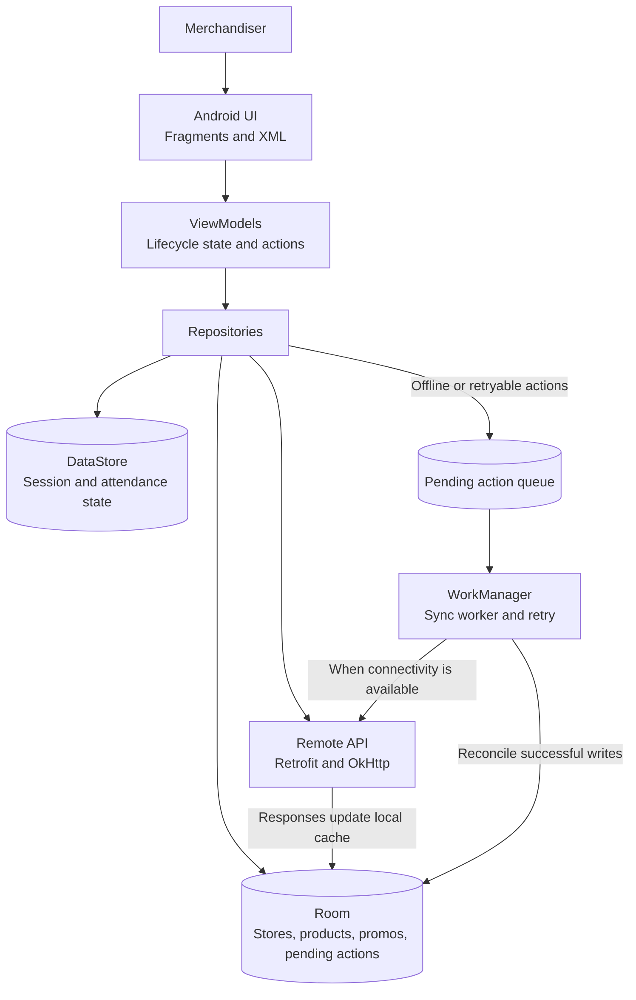

<p align="center">
  
</p>

<p align="center">
  <strong>Field operations, ready for the next store visit.</strong><br />
  MerchGo helps merchandisers manage attendance, stores, products, and promotions from one Android app—even when connectivity is unreliable.
</p>

<p align="center">
  
  
  
  
  
</p>

## What MerchGo helps you do

MerchGo is a field-work companion for recording daily activity and store-level execution. Start and end a shift with a location-aware attendance report, find or create a store, then report product availability and promotions. Work can be captured while offline and queued for synchronization when the connection returns.

### A typical field workflow

1. Sign in and check in with a timestamp, location, and photo.
2. Find a store or add a new one, then open its details.
3. Assign products to the store and report availability or promotions.
4. Check out when the visit is complete. Pending submissions synchronize when connectivity is available.

## Screenshots

<table>
  <tr>
    <td align="center"><strong>Attendance</strong><br /></td>
    <td align="center"><strong>Attendance recorded</strong><br /></td>
    <td align="center"><strong>Stores</strong><br /></td>
    <td align="center"><strong>Store details</strong><br /></td>
  </tr>
</table>

## Product capabilities

- **Attendance:** check in and check out with a selfie, timestamp, and location; retain attendance session state.
- **Store visits:** browse and search stores, add stores, and view store details.
- **Product execution:** create products, assign them to stores, render CODE-128 barcodes, and submit availability reports.
- **Promotions:** record promotions for products at a store.
- **Resilient field work:** read cached store and product data, save supported work locally, and retry pending submissions in the background.

## How the app is organized

The app uses MVVM with repositories as the boundary between presentation and data. Screens observe state from ViewModels; repositories coordinate API calls with Room, DataStore, and the pending-action queue. WorkManager runs queued synchronization, while Retrofit and OkHttp connect to the MerchGo API.



The UI reads local state through repositories, so cached data remains available without a network connection. Supported writes are stored as pending actions and synchronized in the background; successful server responses reconcile local records.

## Run the app

### Requirements

- Android Studio with Android SDK 36 installed
- JDK 21
- Android device or emulator running Android 7.0 (API 24) or newer

### Build and launch

```bash
git clone <repository-url>
cd MerchGo-App
./gradlew assembleDebug
```

Open the project in Android Studio and run the `app` configuration on a device or emulator. The debug build is configured to use `https://dev-api.fhanafii.my.id/`.

## Backend API

- [Interactive API documentation](https://dev-api.fhanafii.my.id/docs)
- [OpenAPI specification](https://dev-api.fhanafii.my.id/openapi.json)

## Project layout

```text
app/src/main/java/com/fhanafi/pitjarus/
├── data/       API, Room, repositories, and synchronization
├── datastore/  session and attendance preferences
├── di/         dependency injection modules
├── ui/         login, attendance, store, product, and promo screens
└── utils/      shared UI, network, and formatting helpers
```

## Contributing

This project was created for the Pitjarus Mobile Developer Technical Assessment. Contributions and focused improvements are welcome through pull requests.

## License

MerchGo is released under the [MIT License](LICENSE).
